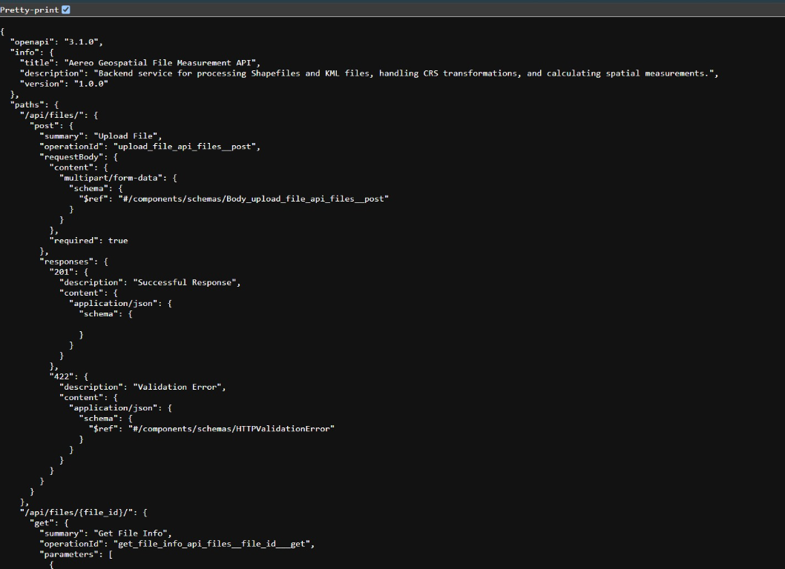
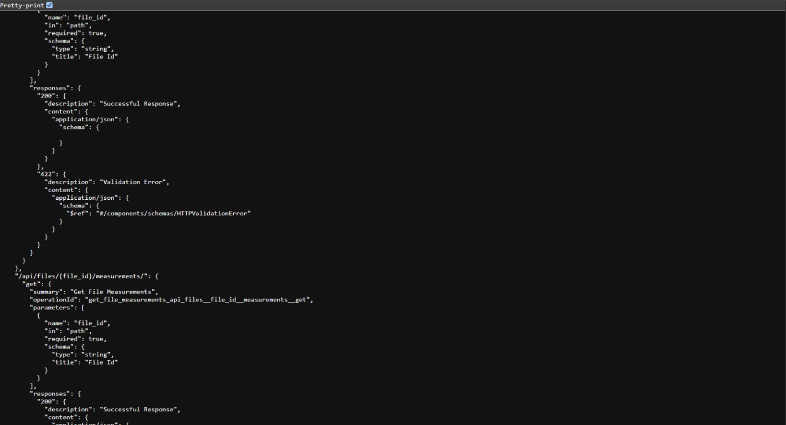
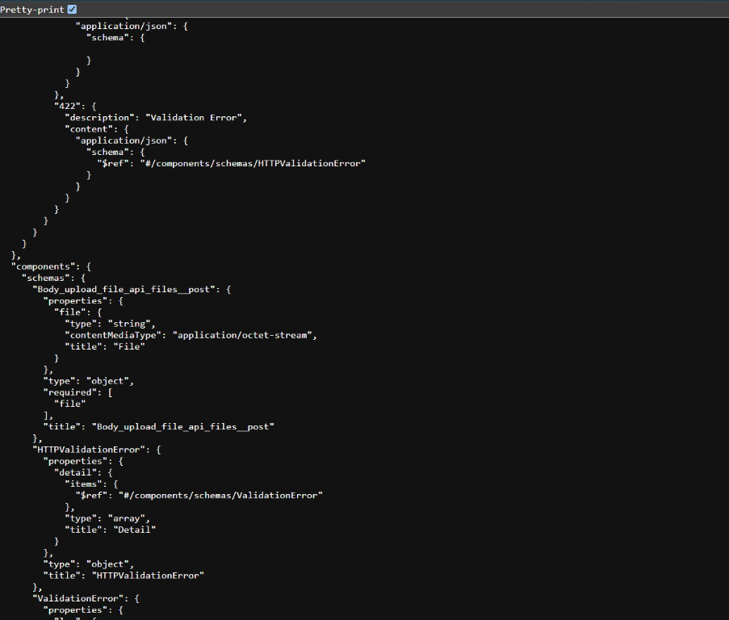
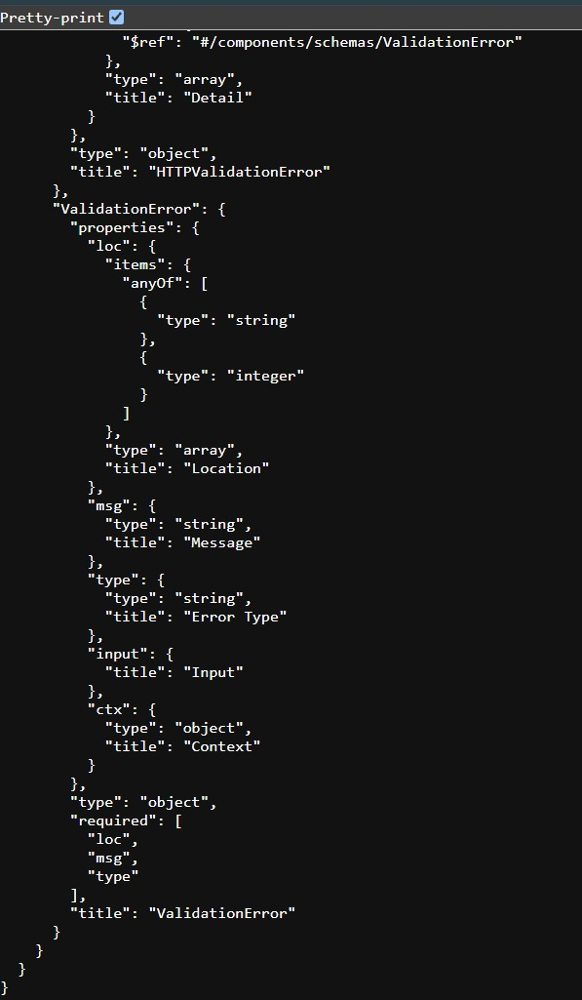

# Geospatial File Measurement API

FastAPI backend that ingests zipped Shapefiles and KML/KMZ files, extracts vector features,
handles CRS transformations and returns accurate per-feature measurements.

## Run
```bash
pip install -r requirements.txt
uvicorn main:app --reload        # docs at http://localhost:8000/docs
# or
docker build -t aereo-geo . && docker run -p 8000:8000 aereo-geo
```
Tests: `pytest`

## Endpoints
| Method | Path | Description |
|---|---|---|
| POST | `/api/files/` | Upload `.zip` (Shapefile) / `.kml` / `.kmz` as multipart field `file`. Returns `201` with id, filename, feature_count, crs, status. `400` on unsupported/corrupt files. |
| GET | `/api/files/{id}/` | File metadata. `404` if unknown. |
| GET | `/api/files/{id}/measurements/` | Per-feature geometry (WKT), measurement, unit, status, properties. |

```bash
curl -F "file=@plots.kml" localhost:8000/api/files/
curl localhost:8000/api/files/<id>/measurements/
```

## How measurements work
- Source CRS is read from the file (`.prj` for Shapefiles); files without one are assumed `EPSG:4326`.
- Geographic CRSs (degrees) are reprojected to the best-fit **UTM zone** (`estimate_utm_crs`, fallback `EPSG:3395`)
  before measuring, so areas/lengths are in real metres — never in squared degrees.
- Polygon/MultiPolygon → `square_meters`; LineString/MultiLineString → `meters`; Point → `0.0`;
  other geometry types are flagged `UNSUPPORTED_GEOMETRY`.
- Attribute NaN/NaT values are normalised to `null` so responses are always valid JSON.

## Known limitations / next steps
- Storage is in-memory (`FILE_STORE`); swap for PostgreSQL/PostGIS + background processing for large files.
- No auth or upload size limit yet.

## Screenshots








